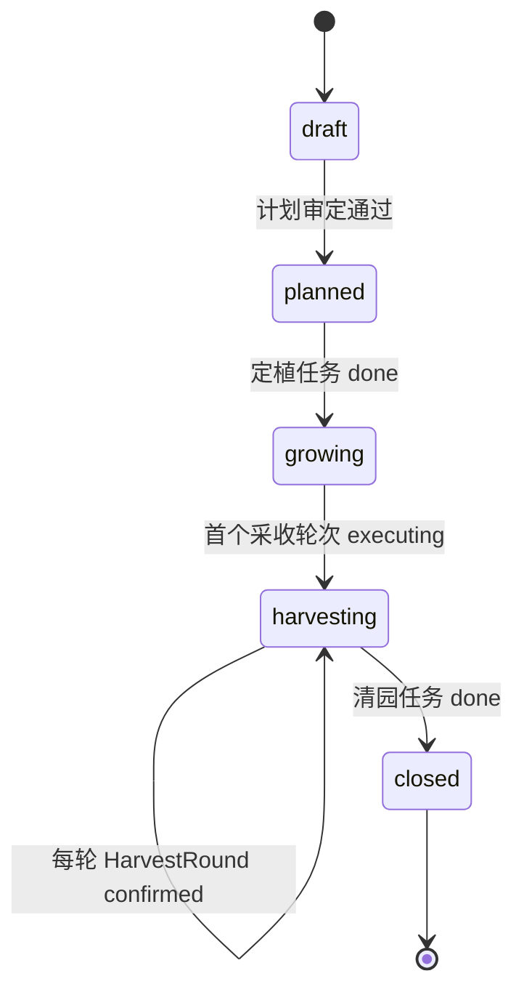
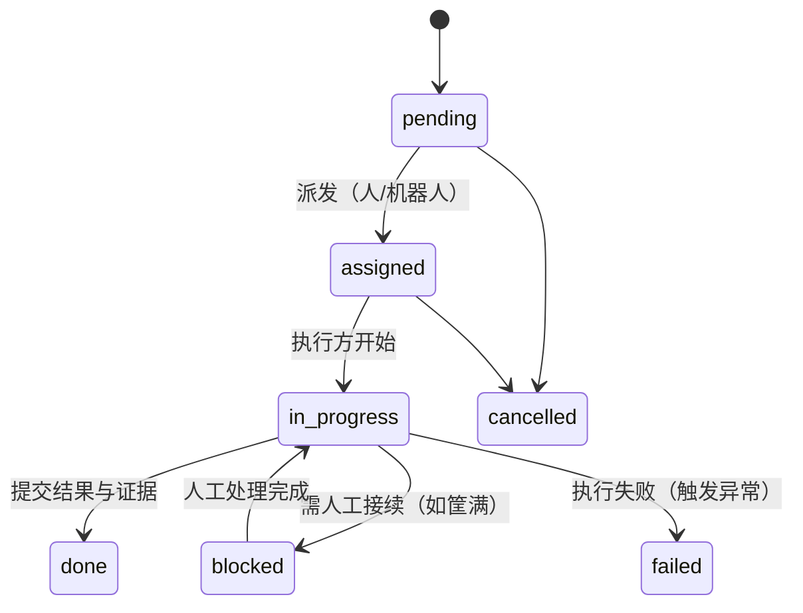
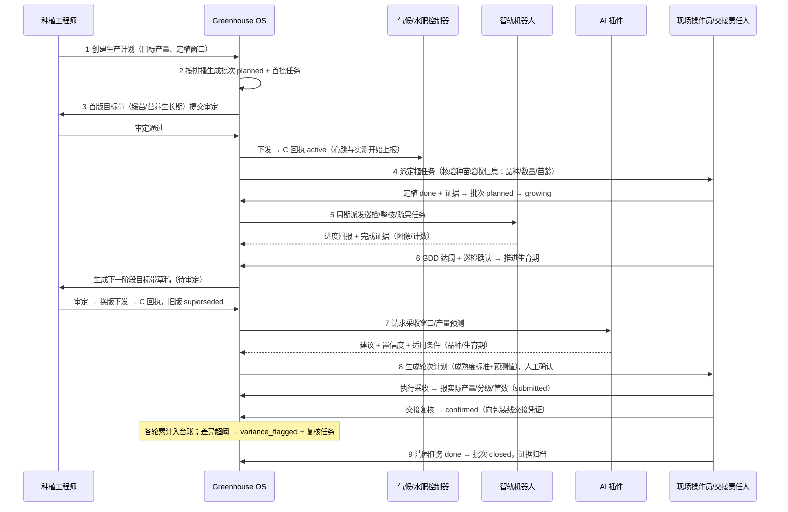
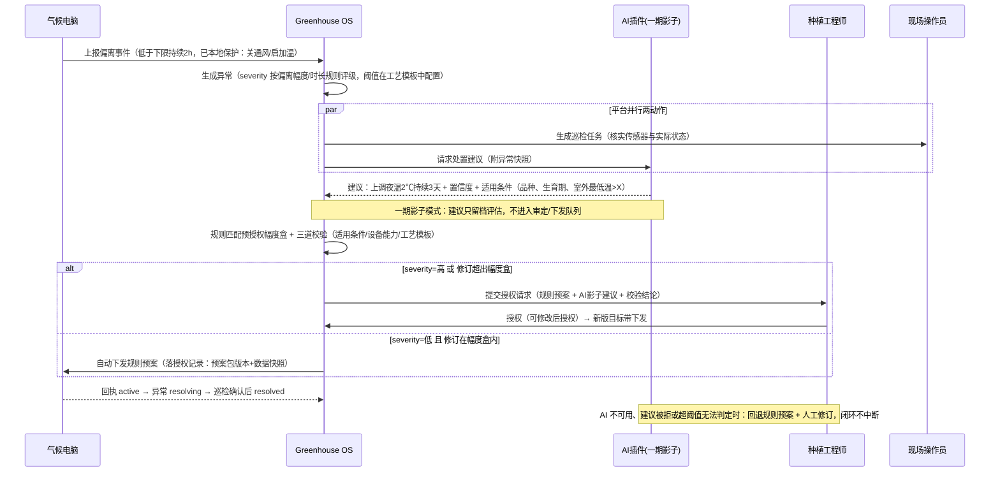

# 02 一期核心业务闭环：番茄智轨产线批次执行闭环

> 本篇把所选闭环讲透：触发方式、核心业务对象及关键状态、人/平台/设备的接口分工、正常流程、异常与人工接管、验收方案，以及支撑设计的少量农业/AI 判断的调研核查。对象、字段细化到能说明闭环如何实现为止，不追求完整接口文档。

## 1. 选择与理由

**闭环定义**：从"创建番茄生产计划与批次"开始，经"环境/水肥目标带下发 → 作业任务执行与反馈 → 生育期推进 → 采收轮次执行与确认"，到"批次关闭与证据归档"结束的一条完整业务环。

**它服务于什么目标**：

- 芯鲜派展示中心的首期示范作物就是番茄智轨产线——设备联调、系统验证、参观展示都以它为第一现场；
- 公司对平台的验收标准是"从生产目标到现场执行反馈的可运行闭环"，本闭环就是这句话的直接落点。

**为何优先（对照其他候选）**：

| 候选闭环 | 对比结论 |
| --- | --- |
| 种苗接口与定植批次 | 只是本闭环的第一个触发源（批次创建），单独成环覆盖对象太少 |
| 采收交接与商品交付 | 是本闭环的下游出口（采收轮次确认即交接），包装线内部属另一专业域 |
| 巡检与作物维护 | 是本闭环中任务子系统的一个子集，且单独做缺少"目标下发"这一平台特有职责 |

选择本闭环等于**一次把平台的全部核心对象定清楚**：批次、计划、目标带、任务、反馈、异常、授权全部出现，且平台↔气候电脑、平台↔水肥控制器、平台↔智轨机器人三类关键接口全部被覆盖。其他业务环要么是它的子集，要么消费它的输出。

**与其他业务的必要联系**：上游经"批次创建"接口接收种苗/定植信息；下游经"采收轮次确认"接口向采后包装交接；叶菜/芽苗产线复用同一对象模型，仅换工艺模板。

## 2. 触发方式

闭环由三类触发源启动或推进：

| 触发源 | 发起者 | 结果 |
| --- | --- | --- |
| **计划触发** | 种植工程师按销售/展示目标创建生产计划，指定定植窗口与目标产量 | 到期自动创建批次（planned）并生成首批任务 |
| **事件触发** | 批次生育期推进事件（如"营养生长→开花坐果"） | 自动生成新版环境/水肥目标带（待审定）与阶段任务模板 |
| **人工触发** | 现场操作员报告异常（如叶片症状、设备异响） | 创建异常事件，按规则转化为巡检/处置任务 |

## 3. 核心业务对象及关键状态

### 3.1 对象总览

| 对象 | 关键字段 | 关键状态与迁移 |
| --- | --- | --- |
| **CropBatch** 作物批次 | batch_id、**plan_id**、line_id、品种、株数、定植日、当前生育期、预计采收窗口 | `draft → planned → growing → harvesting → closed`；一个计划可按排播分期产生多个批次（1:N，外键持于批次侧）；closed 为终态，关闭后的产量更正只追加更正记录、不改历史轮次；生育期独立维护（见 3.2） |
| **ProductionPlan** 生产计划 | plan_id、目标产量、定植窗口、预计采收窗口、周任务模板、version | `draft → active → closed` |
| **EnvironmentTarget** 环境/水肥目标带 | target_id、scope（区段/槽位组）、kind（climate / irrigation）、items[]（指标、min、max、单位）、effective_window、version、source（rule / model）、pre_authorized（是否落在预案幅度盒内，见 6.1） | `draft → pending_review → approved → issued（已下发待回执）→ active`；审定驳回 → `rejected`（留痕，可据其内容另起草新版草稿）；`active → superseded（被新版本替代）/ revoked`；版本只增不改，旧版留档 |
| **WorkTask** 作业任务 | task_id、batch_id、type（巡检/整枝/疏果/采收/清园/设备维护）、target（区段或设备）、assignee（人或机器人）、deadline、result、evidence[]（照片/读数/计数） | `pending → assigned → in_progress → done / blocked / failed / cancelled`；blocked 表示需人工接续（如机器人筐满提醒）；in_progress 不可直接 cancel，防止在途机器人任务被撤销造成现场与平台不一致，只能 blocked 或 failed |
| **HarvestRound** 采收轮次 | round_id、batch_id、计划日期、成熟度标准（breaker/turning/…）、预测产量、实际产量、分级（A/B/C）、筐数、confirmed_by | `planned → executing → submitted（操作员报数）→ confirmed（交接责任人复核，即向包装线的交接凭证）`；确认时差异超阈则打 `variance_flagged` **标记**并生成复核任务——它附属于 confirmed、不是并列终态，漏采补作业的补采量计入本轮 |
| **ExceptionEvent** 异常 | exc_id、source（任务/设备/目标带）、kind、severity、检测数据快照、suggested_action、source_type（rule / model） | `open → acknowledged → resolving → resolved`；任意阶段可 `escalated`（升级），上级接手后回到 resolving——escalated 不是终态，异常台账中不允许悬挂 |
| **AuthorizationRecord** 人工授权 | auth_id、关联对象（异常/任务/目标带修订）、决策人、角色、决策、理由、时间 | 不可变记录，构成证据链；规则预案自动执行时也落一条（actor=预案包版本 + 触发数据快照） |

### 3.2 批次主状态机



两点语义约定：

- **planned 阶段对应育苗/待定植**：育苗发生在定植前（种苗接口，见 01 §4），定植任务完成并核验种苗验收信息后才进入 growing；缓苗是定植后的第一个田间生育期。因此首版目标带可在 planned 阶段提前审定下发给控制器（预热/环境预置），但批次状态仍以定植为准迁移。
- **harvesting 的进入时点**：生育期推进到"盛果采收"后，首个采收轮次经人工确认进入 executing，批次才进入 harvesting；清园任务 done 是唯一出口。

批次内的**生育期**（育苗 → 缓苗 → 营养生长 → 开花坐果 → 盛果采收）作为独立字段推进，与批次状态正交：它是环境/水肥目标带的版本驱动器，也是作业任务模板的切换依据。生育期推进采用**双条件**：积温（GDD，传感器实测累积）达到阈值 **且** 人工巡检确认——只有积温不自动切阶段，避免模型误差直接改变控制目标。

**GDD 与数据缺口的配合**：GDD 只产生"建议推进"提醒、不产生任何自动切换，因此缺口处理采取保守策略——控制器离线或传感器缺失时段不插值（§4 原则 3），该时段 GDD 累积值标记"含缺口"，提醒置信度降级；恢复后以缺口前后有效实测的下限做估算并显式标注 `estimated`，或直接等待人工巡检结论。任何情况下人工巡检确认都是切换的最终条件，缺口只影响提醒时机、不影响正确性。

### 3.3 作业任务状态机



## 4. 参与者与接口

| 参与者 | 交换内容 | 接口形式 | 时机 |
| --- | --- | --- | --- |
| 平台 → 气候电脑 / 水肥控制器 | 目标带报文（scope、items 上下限、effective_window、version） | 消息接口，要求回执（issued → active） | 目标带审定后下发；修订时发新版本 |
| 控制器 → 平台 | 心跳与实测值（周期）；偏离事件（越界持续超阈值）；本地处置通知（互锁/保护动作） | 事件上报，带设备侧序号与时间戳 | 周期性 + 事件触发 |
| 平台 → 智轨调度 / 机器人 | 作业任务（巡检路线、采收槽位与成熟度要求） | 任务下发 + 进度回报（到站/开始/完成/失败）+ 证据（图像/计数） | 任务派发后 |
| 平台 → AI 插件（同一插件通道，两个能力） | ① 采收排产预测：批次上下文快照（品种、GDD 累积、近期实际产量）；② 异常处置建议：异常快照 + 当前目标带 | 统一请求—响应契约：建议 + 置信度 + 适用条件（须含品种与当前生育期）。① 一期启用，结果仅作排产参考、经人工确认才成轮次计划；② 一期**影子模式**：建议照常生成并留档供事后评估准确率，但不进入审定/下发队列，异常处置实际走规则预案与人工授权（见 6.1） | ① 采收排产前、每轮结束后；② 异常生成时（影子） |
| 平台 → 人（种植工程师/操作员/自动化工程师） | 待办、授权请求、异常通知 | 平台待办 + 通知 | 按状态机条件产生 |
| 人 → 平台 | 审定、授权、任务反馈、异常报告 | 表单操作，落 AuthorizationRecord / task.result | 响应待办时 |

**接口通用原则**（第一题已验证语义的延续）：

1. 所有下行指令带 `version`，**幂等**：重复下发返回已知结果（duplicate），过期版本返回冲突（conflict），不产生新动作；
2. 所有上行事件带设备侧序号与时间戳，乱序可对账；
3. 数据缺口（设备离线时段）**显式标记，不用插值冒充实测**；
4. 计划完成不等于设备已执行——平台状态以回执与实测为准。

## 5. 正常流程



文字说明（按阶段，对应图中序号）：

1. **计划与批次**：种植工程师创建生产计划；系统按排播槽位生成一个或多个批次与首批任务，批次进入 planned。
2. **目标带生命周期**：每版目标带"生成（规则/模型标注来源）→ 审定（可驳回留痕）→ 下发 → 回执 → active"，修订一律发新版本，旧版 superseded 留档可追溯。计划阶段下发的首版目标带用于环境预置，不改变批次状态。
3. **定植**：定植任务完成且种苗验收信息核验通过，批次才 planned → growing——这是"计划完成不等于现场已执行"原则在批次级的落点。
4. **日常任务**：周模板生成巡检、整枝、疏果任务，派发给操作员或智轨机器人；完成必须附证据（照片/读数），无证据不闭环；机器人在途任务不可撤销，只能 blocked/failed。
5. **生育期推进**：GDD 实测累积达阈值（含缺口时降级为估算提醒）+ 人工巡检确认 → 推进生育期 → 自动生成下一阶段目标带草稿，经审定后版本递增下发。
6. **采收轮次**：结果期平台向 AI 插件请求预测、人工确认后生成轮次计划（含成熟度标准）；执行后操作员报数（submitted），交接责任人复核数量/分级/筐数后 confirmed，构成向包装线的交接凭证；预测与实际的差异自动入台账。
7. **批次关闭**：拉秧清园任务完成 → 批次 closed；closed 不可重开，事后产量更正只追加更正记录；全程时间线（目标带版本、任务、异常、授权）归档，支撑复盘与讲解。

## 6. 异常处理与人工接管

### 6.1 重点场景：夜温持续低于目标带下限



处理要点：

- **现场自治在先，平台事后协同**——控制器本地保护动作不等平台指令，平台收到的是"已偏离 + 已处置"通知，因此不存在平台失联导致现场失控的问题；
- **预授权幅度盒**消解"每版必审定"与"自动下发"的表面矛盾：规则预案（如夜温上调的最大幅度、最长持续时间、允许的生育期）在工艺模板审定时一次性授权，盒内自动执行且每次落授权记录（actor=预案包版本 + 触发数据快照）；超出幅度盒或 severity=高 一律强制人工授权，即使三道校验全过；
- AI 建议的适用条件必须包含**品种与当前生育期**——例如花期夜温上调可能影响坐果，此类物候禁忌由工艺模板约束兜住；一期 AI 处置建议为影子模式，真实执行路径始终是规则预案与人工授权；
- AI 插件不可用或建议被拒 → 回退到规则预案 + 人工直接修订目标带，闭环不中断。

### 6.2 简要场景 B：采收轮次实际产量低于预测 30% 以上

轮次在交接复核时（submitted → confirmed）发现差异超阈 → confirmed 同时打 `variance_flagged` 标记并生成复核任务（交接不阻塞、轮次不悬挂）。复核结论三选一：漏采 → 补作业，补采量追加计入**本轮**并留前后两次记录；病虫害 → 转异常流程；预测偏差 → 把本轮实际值作为校准样本记录并更新后续轮次预测。AI 预测参数的每次校准都留记录——这本身就是"模型可替换、可验证"的运行证据。

### 6.3 简要场景 C：水肥控制器离线

下发失败标记 `未送达`（不静默重试）→ 通知自动化工程师 → 控制器断网期间按既有策略自治（题面要求的能力）→ 恢复后补传执行记录 → 平台对账并显式标记数据缺口时段 → 未送达的目标带以**同一版本**重新下发（幂等，不产生新版本）。

### 6.4 人工确认/接管点清单

| 节点 | 触发条件 | 谁 | 形式 |
| --- | --- | --- | --- |
| 目标带审定 | 工艺模板/阶段换版的新版本首次下发前；审定可驳回（rejected 留痕） | 种植工程师 | 审定操作，落授权记录 |
| 异常处置授权 | severity=高，或目标带修订超出预授权幅度盒（未来 AI 建议启用时同理必经此节点） | 种植工程师 | 授权请求（可修改后授权） |
| 生育期切换确认 | GDD 达阈（含缺口估算提醒） | 操作员巡检确认 | 任务确认，双条件齐备才推进 |
| 采收轮次计划确认 | 每轮排产前（AI 预测仅参考） | 操作员 | 确认操作 |
| 采收轮次交接复核 | 轮次 submitted | 交接责任人（现场负责人） | 数量/分级/筐数复核后 confirmed |
| 产量差异复核结论 | variance_flagged | 种植工程师 | 复核任务结论（补采/异常/校准三选一） |
| 设备离线处置 | 控制器心跳超时 | 自动化工程师 | 待办通知，恢复后对账确认 |

规则预案在幅度盒内的自动执行**不是**漏掉的人工节点：其授权在工艺模板审定时一次性完成，执行记录可逐笔追溯（见 6.1）。

## 7. 验收方案

验收分模拟器环境与真机环境两轮（真机视项目进度，为加分项）。以下每条都是**可观察的结果或证据**：

1. **全流程演示**：从创建计划到批次 closed 完整走通，含定植任务触发 planned → growing、至少 1 次生育期换版、3 个以上采收轮次（submitted → confirmed 两步留痕）；每一步的状态变更与时间戳在批次时间线可查。
2. **状态机负面验证**：对批次/任务/目标带尝试非法迁移（如 planned 直接 harvesting、in_progress 任务 cancel、closed 批次重开）一律被拒绝，拒绝事件入台账；rejected 的目标带与驳回意见可查。
3. **幂等与版本对账**：同一目标带报文重复下发，第二次返回 duplicate 且不产生新版本；过期版本返回 conflict（对应第一题已验证语义）；任意时点每台控制器回执的 active 版本与平台记录逐台一致，旧版 superseded 序列完整。
4. **异常演练（预授权边界）**：向模拟器注入"夜温低于下限 4℃、持续 2h"事件 → 系统在 1 分钟内生成异常事件与巡检任务；盒内低 severity 修订自动下发且带预案授权记录；高 severity 或盒外修订**在人工授权前不出现在设备侧**（设备侧报文留痕比对）；AI 影子建议有留档、无下发记录。
5. **降级验证**：停用 AI 插件 → 采收轮次可纯人工创建并继续闭环，异常处置走规则预案与人工授权，其余环节无感；恢复后影子建议与实际处置的偏差可对比。
6. **断网演练**：断开模拟控制器 → 目标带显示"未送达"、自动化工程师收到通知；恢复后补传数据完成对账，缺口时段被显式标记，GDD 提醒显示"含缺口/估算"；未送达目标带以同版本重下成功且不产生新版本。
7. **证据链抽查**：随机抽 1 个批次导出时间线——目标带版本序列（含驳回）、任务台账、异常台账（无悬挂的 escalated）、授权记录齐全，每条含 actor + reason + timestamp；规则预案自动执行的记录可追溯到预案包版本。
8. **产量对账**：各轮次预测/实际差异全部落在台账中，variance_flagged 的复核结论（补采/异常/校准）可查；批次累计产量与各轮 confirmed（含补采追加）之和一致。
9. **模拟器→真机替换演练**：以同一套闭环用例，将三个模拟器中的任一个替换为适配器对接的真机或厂商测试环境，业务用例零修改跑通——验证"真机接入只替换适配器"的假设 A1。

## 8. 调研核查：影响设计的四个判断

### 判断 1：番茄按轮次连续采收，不是一次采收（影响最大）

- **依据**：商业温室番茄每 3-4 天采收一次、每周 2-3 次（亚利桑那大学 CEAC《Fruit Harvesting, Grading and Storage》教材原文："Tomato fruit should be harvested every 3-4 days or 2-3 times / week"，[原文 PDF](https://ceac.arizona.edu/sites/default/files/Chapter%208%20-%20Fruit%20Harvesting%20Grading%20and%20Storage.pdf)）；成熟度按美国官方法规分期——breaker（≤10% 果面转色）、turning（>10% 且 ≤30%）、pink（>30% 至 ≤60%）（7 CFR §51.1860 [Color classification](https://www.ecfr.gov/current/title-7/subtitle-B/chapter-I/subchapter-C/part-51/subpart-S/subject-group-ECFR23199cd1e0bd4d1/section-51.1860)；Univ. of Florida IFAS [VH079](https://ask.ifas.ufl.edu/publication/VH079)），不同成熟度对应不同销售场景（breaker 耐运输、light red 适合本地即销）。
- **适用条件**：鲜食串收/单果番茄；加工番茄或一次性采收品种不适用。
- **对设计的影响**：**改变了设计**——最初把"采收"作为批次的单次状态迁移，调研后确认不符合生产行为，改为采收轮次（HarvestRound）子对象；批次 harvesting 是持续阶段，以清园任务完成为终点；成熟度标准成为轮次必填字段与验收判据。

### 判断 2：积温（GDD）驱动的生育期/产量预测是成熟做法，但品种参数必须本地校准

- **依据**：多项研究以定植后天数与 GDD 为自变量建立温室番茄生长预测模型（Gompertz/Logistic 曲线）；CROPGRO-Tomato 等机理模型依赖基点温度参数；"定植到首采约 837 度·日"出自阿根廷拉普拉塔国立大学温室番茄研究（Horticultura Argentina，[原文 PDF](https://www.horticulturaar.com.ar/es/pdf/395/tomate-en-la-plata-estimacion-de-dias-a-cosecha-y-analisis-de-la-temperatura-segun-fecha-de-trasplante.pdf)），原文明确称其为 *valor de referencia*（参考值），基于当地 2016–2021 年气温/土温记录——只可作量级参照，不是可移植常数。
- **适用条件**：模型按具体品种与气候训练；参数未经本地校准时误差不可控。
- **对设计的影响**：AI 预测输出限定为"建议 + 置信度 + 适用条件"；生育期切换必须人工确认，预测在未校准前只用于排产参考、不驱动自动控制——直接落实题面"模型建议需经适用条件、约束和授权检查"的要求。

### 判断 3：水肥 EC 靶标随生育期阶梯上升

- **依据**：梯度上升规律多源一致，但具体数值存在不可忽视的来源间差异：亚利桑那大学 CEAC 2026 温室番茄水肥工坊的 hydroponic recipes 按 Propagation / Vegetative / Generative / Balanced 分阶段配方（[PDF](https://be.arizona.edu/sites/default/files/2026-01/Module-3-Hydroponic-Nutrient-Solutions-Workshop-2026.pdf)）；英文栽培资料给出幼苗 0.8-1.2、营养期 1.4-2.4、开花结果 2.2-3.5 mS/cm；而中国地方农技资料（[宁德市农业农村局](https://nyncj.ningde.gov.cn/ztzl/nyscs/njfw/202402/t20240219_1916261.htm)）给出开花坐果 1.8-2.1、三穗果后 2.5-2.7 mS/cm——花期数值差异明显。
- **适用条件**：因品种、基质、气候而异，数值必须由种植方确认；来源间的数值差异本身就是"必须可配置"的证明。
- **对设计的影响**：**强化了架构决策**——目标带建模为"生育期驱动的版本化配置"，平台不写死任何农业数值，由种植工程师维护工艺模板；平台架构与农业知识解耦。

### 判断 4：轨道/移动式采收机器人已有落地案例，"任务—进度—接管"接口模式可行

- **依据**：国内具身智能双臂番茄采摘机器人（陆轨两用底盘）已通过多轮实地测试，公开报道采摘成功率约 90%；国外温室机器人工程案例显示其沿行作业、自动换筐，需人工卸筐时主动提醒。
- **适用条件**：设备成熟度以项目逐项确认为准（题面原话）；报道性能不等于本产线设备能力。
- **对设计的影响**：智轨设备接口按"任务下发—进度回报—完成/异常事件—人工接管点"设计；"机器人提醒人工卸筐"这类半自动行为建模为 `blocked`（待人工接续）而非 `failed`，避免把正常的人机协作误报为故障。

## 9. 待确认事项与最小验证

| 事项 | 谁确认 | 未确认时如何成立 | 最小验证 |
| --- | --- | --- | --- |
| 智轨设备接口协议与能力清单 | 自动化/项目组 | 按 A1 假设用模拟器推进，真机只替换适配器 | 索取设备接口文档，或与厂商一次接口对齐会 |
| 番茄品种与采收成熟度标准 | 种植工程师 | 成熟度标准为轮次可配置字段，默认 breaker/turning | 一次种植方案评审会 |
| 工艺模板数值（温度带、EC 靶标） | 种植工程师 | 全部走配置，用公开资料区间占位并标注"待种植方确认" | 模板评审 + 首批次试运行校核 |
| GDD 阈值参数 | 种植工程师 | 双条件推进机制保证阈值不准时不误切换 | 首批次用实测数据回溯比对 |

## 10. 关键逻辑伪代码（Python，仅说明两处核心语义）

**目标带版本化幂等下发**（与第一题 duplicate/conflict 语义一致；判定基于设备已回执的 active 版本，故未送达的同版本重发仍是 issued 而非 duplicate；在途状态须持久化，进程重启后语义不变）：

```python
# 下行只对"设备已确认生效的版本"判重，保证断网恢复后同版本重发合法。
def issue_target(device, target):
    active = device.active.get(target.scope)
    if active and active.version == target.version:
        return Ack(status="duplicate", version=active.version)
    if active and active.version > target.version:
        return Ack(status="conflict", version=active.version)
    device.in_flight[(target.scope, target.version)] = target
    return Ack(status="issued", version=target.version)

# 迟到/乱序回执不抛错丢弃，全部落成可对账事件；只接受不新于在途版本的回执。
def on_device_ack(device, ack):
    target = device.in_flight.pop((ack.scope, ack.version), None)
    active = device.active.get(ack.scope)
    if target is None:
        device.events.append(StaleAck(ack.scope, ack.version, ack.timestamp))
        return
    if active and active.version > ack.version:
        device.in_flight[(ack.scope, ack.version)] = target
        device.events.append(OutOfOrderAck(ack.scope, ack.version, active.version))
        return
    device.active[ack.scope] = target
    target.transition_to_active(ack.timestamp)
```

**状态机合法迁移约束**（所有对象状态变更的唯一入口）：

```python
BATCH_TRANSITIONS = {
    "draft": {"planned"},
    "planned": {"growing"},
    "growing": {"harvesting"},
    "harvesting": {"closed"},
    "closed": set(),
}

def transition(obj, table, to_state, actor, reason, at):
    if to_state not in table[obj.status]:
        raise IllegalTransition(obj.kind, obj.status, to_state)
    obj.status = to_state
    obj.history.append(Event(kind=f"{obj.kind}.state",
                             at=at, actor=actor,
                             reason=reason, state=to_state))
```

所有状态变更必须经过迁移表并留事件记录；越权迁移直接抛错——这是证据链完整性的实现基础。
